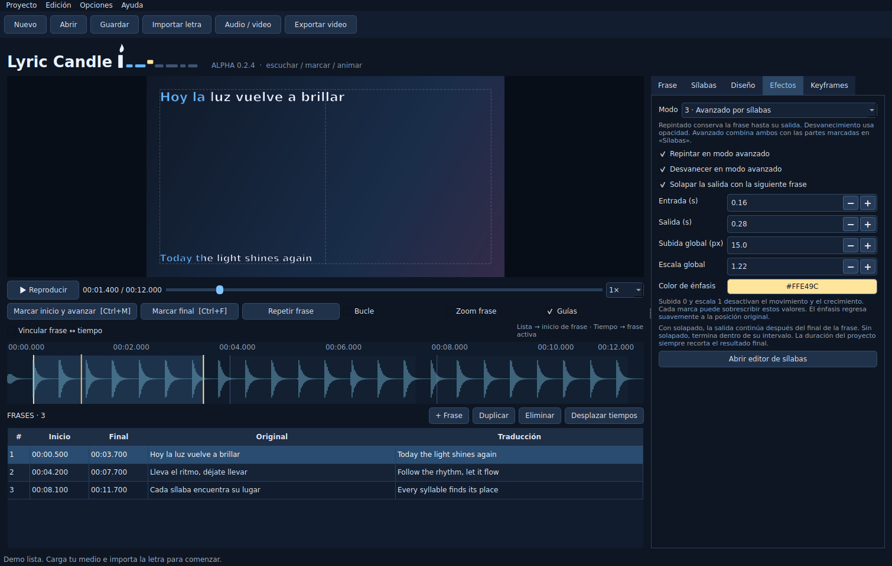

# Lyric Candle

[English](README.md) · [Español](README.es.md)


**Editor de escritorio para sincronizar, traducir y animar letras de canciones.** Desarrollado con Python y PySide6. Versión actual: **0.2.5-alpha**.



Escucha la canción, marca las frases, afina sus tiempos y anima las sílabas o palabras que elijas. Lyric Candle es un proyecto independiente inspirado en Sonic Candle.

## Funciones

- **Una o dos líneas:** original y traducción, con anclajes fijos a izquierda/derecha/centro y tamaños principal/secundario independientes.
- **Tres efectos:** repintado del relleno conservando el contorno, desvanecimiento clásico y modo avanzado con color, subida y escala por sílaba.
- **Editor de tiempos:** forma de onda, extremos de frase, velocidad de reproducción, bucle y vinculación opcional frase ↔ cabezal.
- **Keyframes por frase:** sostén una animación durante una nota larga o acelera un tramo sin cambiar la velocidad del audio.
- **Prueba de fuentes:** pasa el mouse por la lista o por los resultados de búsqueda para previsualizar; confirma para aplicar o pulsa Esc para cancelar.
- **Video de fondo:** restaura el fotograma guardado en pausa y adopta resolución/FPS del medio, incluidas velocidades fraccionarias, rotación y píxeles no cuadrados.
- **Proyectos y recuperación:** guardado JSON, deshacer/rehacer, autoguardado por ventana y borradores de texto sin aplicar que se conservan al guardar.
- **Exportación:** MP4 H.264/AAC o contenedor/códec del video base cuando sea compatible, copiando su audio. Cancelar conserva el archivo de destino anterior.
- **Interfaz en español e inglés:** idioma del sistema al iniciar, selección manual y guía integrada con F1.

**Esta alpha no reconoce el canto ni alinea la voz automáticamente.** Las ayudas estiman por posición del texto o ataques cercanos del audio; revisa escuchando. Por ahora se importa texto pegado y TXT, sin SRT/ASS/LRC.

## Empezar en Windows

### Ejecutar el código fuente

1. Descarga **Code → Download ZIP** y extrae toda la carpeta, o clona el repositorio.
2. Instala **Python 3.12 de 64 bits**. El instalador acepta Python 3.10–3.13; la base probada es 3.12.
3. Ejecuta `INSTALAR.bat`: crea `.venv` e instala PySide6.
4. Ejecuta `INICIAR.bat` para abrir la demo sintética incluida.

Si no inicia, usa `DIAGNOSTICO.bat`. Consulta también la [guía de uso](LEEME.md).

### Ejecutable de Windows

Descarga la **[0.2.5-alpha desde Releases](https://github.com/JAVCIF/lyric-candle/releases/tag/v0.2.5-alpha)**:

- **ZIP portable:** extrae todo y abre `LyricCandle/LyricCandle.exe`. Conserva la carpeta completa. Los ajustes quedan en `data/` junto al EXE.
- **EXE instalador:** instala para tu usuario, con español/inglés, accesos directos y desinstalador. Los ajustes usan la carpeta de datos del usuario.

Ambos son para Windows 10/11 x64 y no requieren Python. Cada descarga incluye su SHA-256. Consulta las [notas bilingües del release](docs/releases/0.2.5-alpha.md). Puedes compilar con `CREAR_EXE.bat` o las [instrucciones de desarrollo](docs/DEVELOPMENT.es.md#compilar-en-windows).

### Agregar FFmpeg

La edición y vista previa pueden abrir sin FFmpeg independiente. **Para exportar, generar la onda, sugerir ajustes por ataques del audio y leer propiedades del video hacen falta sus herramientas.**

- Pon `ffmpeg.exe` y `ffprobe.exe` en `tools/`, junto a `main.py` o a `LyricCandle.exe`, o agrégalos al PATH.
- Descargas: [ffmpeg.org/download.html](https://ffmpeg.org/download.html). El MP4 predeterminado necesita una compilación con `libx264` y AAC.
- El repositorio y el artefacto de Windows no incluyen binarios de FFmpeg.

## Tu primer video en seis pasos

1. **Nuevo → Audio / video:** carga la canción o el video.
2. **Importar letra:** pega parejas alternadas de original/traducción o usa dos columnas.
3. Reproduce y pulsa **Ctrl+M** al comenzar cada frase; **Ctrl+F** al terminar la última.
4. Corrige en la tabla o la onda. Selecciona y marca fragmentos en **Sílabas**.
5. Configura **Diseño**, **Efectos** y los **Keyframes** opcionales. Aplica el texto editado antes de exportar.
6. **Guarda** el proyecto `.lyric.json` y pulsa **Exportar video**.

Guardar también conserva los borradores sin aplicar; al reabrir vuelven a la pestaña Frase. La vista previa usa el texto aplicado y la exportación pide aplicar los pendientes. Los medios se vinculan, no se incrustan: conserva sus archivos.

## Linux / macOS desde código

```sh
python3 -m venv .venv
source .venv/bin/activate
python -m pip install -r requirements.txt
python main.py
```

Instala `ffmpeg` y `ffprobe` por separado. El código es multiplataforma, pero el uso de escritorio y el empaquetado se orientan a Windows. No se incluye empaquetado para macOS.

## Documentación

| Tema | Español | English |
| --- | --- | --- |
| Uso, atajos, formatos y solución de problemas | [Guía de uso](LEEME.md) | [User guide](docs/USER_GUIDE.en.md) |
| Arquitectura, formato del proyecto y compilación | [Desarrollo](docs/DEVELOPMENT.es.md) | [Development](docs/DEVELOPMENT.en.md) |
| Cobertura y límites de las pruebas | [Verificación](VERIFICACION.md) | [Verification](docs/VERIFICATION.en.md) |
| Cambios de versiones | [Cambios / Changelog](CHANGELOG.md) | [Cambios / Changelog](CHANGELOG.md) |
| Reportes y contribuciones | [Contribuir / Contributing](CONTRIBUTING.md) | [Contribuir / Contributing](CONTRIBUTING.md) |
| Componentes externos | [Componentes / Acknowledgements](THIRD_PARTY.md) | [Componentes / Acknowledgements](THIRD_PARTY.md) |

## Estado y límites

El hotfix 0.2.5 agrega ocho regresiones de marcado con zoom; las **154 pruebas pasaron localmente en Linux**. Antes de publicar se exigen CI y comprobaciones de paquetes en Windows.

La base de la 0.2.4 pasó **146 pruebas** en Linux con Python 3.12, PySide6 6.8.3 y FFmpeg 6.1.1, incluidas exportaciones reales. Los indicadores de arriba muestran por separado el resultado de CI del repositorio. Sigue siendo una alpha: comprueba tus códecs, fuentes, salida de audio y entorno de Windows antes de usarla para un trabajo completo.

Un medio por proyecto, sin mezclador de audio/video separados. El texto no se divide automáticamente en más renglones: reduce el tamaño o divide una frase si excede los márgenes. Las fuentes deben estar instaladas en el equipo de destino. El lienzo admite de 320×240 a 3840×2160, dimensiones pares y 1–120 FPS.

## Licencia

El código del proyecto se distribuye con [licencia MIT](LICENSE). Las dependencias conservan sus propias condiciones; consulta [THIRD_PARTY.md](THIRD_PARTY.md).

Creado por [JAVCIF](https://github.com/JAVCIF).
