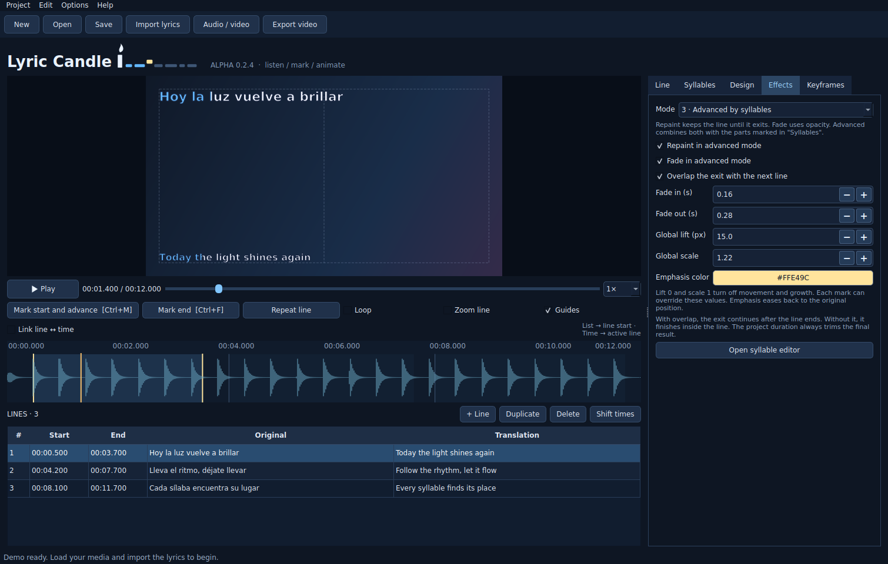

# Lyric Candle

[English](README.md) · [Español](README.es.md)


**A desktop lyric video editor for timing, translating and animating lyrics.** Built with Python and PySide6. Current version: **0.2.6-alpha**.



Listen to the song, mark the phrases, refine their timing, and animate selected syllables or words. Lyric Candle is an independent project inspired by Sonic Candle.

## What it does

- **One or two text lines:** original lyrics and translation, with fixed left/right/center alignment and independent primary/secondary sizes.
- **Three effects:** repaint the fill while keeping the outline, classic fades, or an advanced combination with syllable color, lift and scale.
- **Timing editor:** waveform, phrase boundaries, playback speed, looping and optional phrase ↔ playhead linking.
- **Per-phrase keyframes:** pause the animation over a held note or accelerate part of the phrase without changing the audio speed.
- **Font audition:** hover over installed fonts or search results to preview them; confirm to apply or press Esc to cancel.
- **Video backgrounds:** restore the saved frame while paused; adopt video resolution/FPS, including common fractional rates, rotation and non-square pixels.
- **Projects and recovery:** JSON saves, undo/redo, per-window autosaves and persistent unapplied text drafts.
- **Export:** H.264/AAC MP4, the base video's container/codec where supported (with copied source audio), or the lyrics alone as ProRes 4444 with an alpha channel for overlaying in another editor. Cancellation preserves an existing destination file.
- **Spanish and English UI:** system language at startup, with a manual language option and a built-in F1 guide.

**This alpha does not recognize sung lyrics or perform vocal alignment.** Automatic timing tools estimate by text position or nearby audio attacks; review their results by ear. Import currently accepts pasted text and TXT, not SRT/ASS/LRC.

## Get started on Windows

### Run from source

1. Download **Code → Download ZIP** and extract the entire folder, or clone this repository.
2. Install **64-bit Python 3.12**. The installer accepts Python 3.10–3.14; 3.12 is the reference version.
3. Double-click `scripts\windows\INSTALAR.bat` to create `.venv` and install PySide6.
4. Double-click `scripts\windows\INICIAR.bat` to open the included synthetic demo.

If the app does not start, run `scripts\windows\DIAGNOSTICO.bat`. See [Troubleshooting](docs/USER_GUIDE.en.md#troubleshooting).

### Windows executable

Download **[0.2.6-alpha from Releases](https://github.com/JAVCIF/lyric-candle/releases/tag/v0.2.6-alpha)**:

- **Portable ZIP:** extract everything and run `LyricCandle/LyricCandle.exe`. Keep the entire folder together. Settings live in `data/` beside the EXE.
- **Setup EXE:** install for your Windows user, with English/Spanish setup, shortcuts and an uninstaller. Settings use your application data folder.

Both target Windows 10/11 x64 and need no Python installation. SHA-256 files accompany both downloads. See the [bilingual release notes](docs/releases/0.2.6-alpha.md). Build locally with `scripts\windows\CREAR_EXE.bat` or the [developer instructions](docs/DEVELOPMENT.en.md#building-on-windows).

### Add FFmpeg

Editing and preview can run without a separate FFmpeg installation. **Export, waveform generation, audio-attack suggestions and base-video probing need FFmpeg tools.**

- Put `ffmpeg.exe` and `ffprobe.exe` in `tools/` beside `main.py` or `LyricCandle.exe`, or add them to PATH.
- Download links: [ffmpeg.org/download.html](https://ffmpeg.org/download.html). The default MP4 export needs an FFmpeg build with `libx264` and AAC support.
- FFmpeg binaries are not included in this repository or the Windows artifact.

## First video in six steps

1. **New → Audio / video:** choose the song or video.
2. **Import lyrics:** paste alternating original/translation pairs or use two columns.
3. Play and press **Ctrl+M** at each phrase start; press **Ctrl+F** at the final phrase's end.
4. Correct timing in the table or waveform. Select and mark syllables in **Syllables**.
5. Set **Design**, **Effects** and optional **Keyframes**. Apply edited text before export.
6. **Save** the `.lyric.json` project, then **Export video**.

Saving also preserves unapplied drafts; they return to the Line tab when reopened. The preview uses applied text, and export asks you to apply pending drafts first. Media are linked, not embedded: keep the source files.

## Linux / macOS source setup

```sh
python3 -m venv .venv
source .venv/bin/activate
python -m pip install -r requirements.txt
python main.py
```

Install `ffmpeg` and `ffprobe` separately. The source is cross-platform, but desktop use and packaging focus on Windows. macOS packaging is not provided.

## Documentation

| Topic | English | Español |
| --- | --- | --- |
| User guide, shortcuts, formats and troubleshooting | [User guide](docs/USER_GUIDE.en.md) | [Guía de uso](docs/USER_GUIDE.es.md) |
| Architecture, project format, development and packaging | [Development](docs/DEVELOPMENT.en.md) | [Desarrollo](docs/DEVELOPMENT.es.md) |
| Test coverage and verification limits | [Verification](docs/VERIFICATION.en.md) | [Verificación](docs/VERIFICATION.es.md) |
| Release changes | [Changelog / Cambios](CHANGELOG.md) | [Changelog / Cambios](CHANGELOG.md) |
| Bug reports and contributions | [Contributing / Contribuir](CONTRIBUTING.md) | [Contributing / Contribuir](CONTRIBUTING.md) |
| Third-party components | [Acknowledgements / Componentes](THIRD_PARTY.md) | [Acknowledgements / Componentes](THIRD_PARTY.md) |

## Status and limits

0.2.6 adds twenty-two regression tests for the Ctrl+M target and provisional times (176 tests in total). Run the whole suite with `scripts\windows\PROBAR.bat` or `python -m unittest discover -s tests`. Windows CI and package checks are required before publishing.

The 0.2.4 baseline passed **146 tests** on Linux with Python 3.12, PySide6 6.8.3 and FFmpeg 6.1.1, including real exports. The Actions badges above report repository CI separately. This remains an alpha: test your own codecs, fonts, audio output and Windows environment before relying on it for a complete production workflow.

One media file per project; no separate audio/video mixer. Text does not automatically wrap into extra lines: reduce the font or split a phrase when it exceeds the margins. Fonts must be installed on the destination machine. The editor's canvas limits are 320×240 through 3840×2160, with even dimensions and 1–120 FPS.

## License

The project code is available under the [MIT license](LICENSE). Third-party dependencies retain their own license terms; see [THIRD_PARTY.md](THIRD_PARTY.md).

Created by [JAVCIF](https://github.com/JAVCIF).
